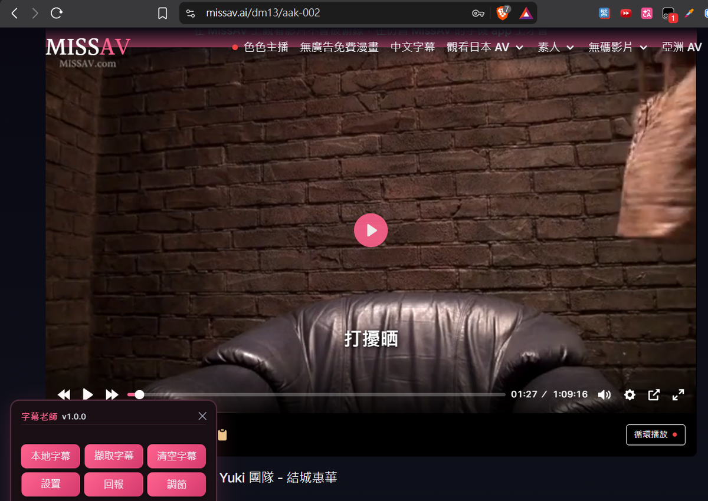
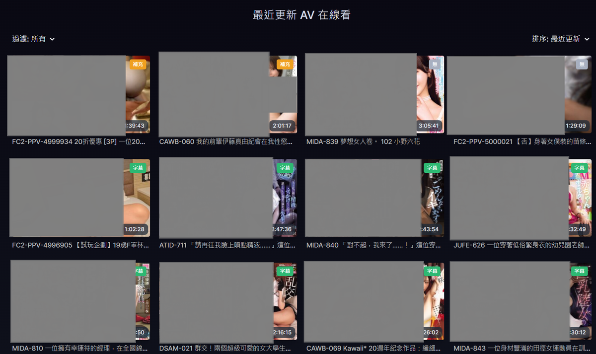
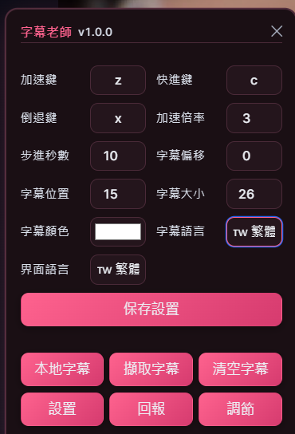
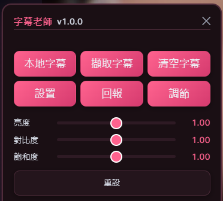
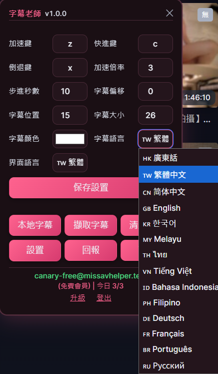
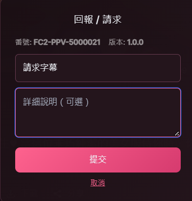

# SubSensei ｜ 字幕老師

> **The only place to obtain supporter status is [Buy Me a Coffee](https://buymeacoffee.com/neo2codes).**
> Any other service claiming to offer "supporter access" or "unlocked subtitles" is unofficial.

[中文版](README.md)

---

**SubSensei (字幕老師)** is the official browser userscript of the
[**Subtitle Instrumentality Project (SIP) ｜ 字幕補完計劃**](PROJECT.md).

Goal: **Build a complete multilingual subtitle library for JAV.**
Current: **316,481 subtitles across 14 languages, still growing.**

**Supported platforms: 🖥️ Desktop (Windows / macOS / Linux) · 📱 iOS · 🤖 Android**

---

### Feature Overview

| Main view | List-page badges |
|---|---|
|  |  |

| Settings panel | Picture adjustment |
|---|---|
|  |  |

| Subtitle languages (14) | Report / request |
|---|---|
|  |  |

---

## Contents

- [Platform Support](#platform-support)
- [Installation](#installation)
- [Supported Sites](#supported-sites)
- [Subtitle Languages](#subtitle-languages)
- [Free vs. Supporter](#free-vs-supporter)
- [Supporter Benefits](#supporter-benefits)
- [Usage](#usage)
- [Keyboard Shortcuts](#keyboard-shortcuts)
- [FAQ](#faq)
- [Privacy](#privacy)
- [License Scope](#license-scope)

---

## Platform Support

| Platform | Browser | Userscript Manager | Status |
|---|---|---|---|
| **🖥️ Windows / macOS / Linux** | Chrome / Edge / Brave / Opera | [Tampermonkey](https://www.tampermonkey.net/) | ✅ |
| **🖥️ Windows / macOS / Linux** | Firefox | [Tampermonkey](https://addons.mozilla.org/firefox/addon/tampermonkey/) | ✅ |
| **🖥️ macOS** | Safari | [Tampermonkey](https://apps.apple.com/app/tampermonkey/id1482490089) or [Userscripts](https://apps.apple.com/us/app/userscripts/id1463298887) | ✅ |
| **📱 iOS / iPadOS** | Safari | [Userscripts](https://apps.apple.com/us/app/userscripts/id1463298887) (free) | ✅ |
| **📱 iOS / iPadOS** | Safari | [Tampermonkey](https://apps.apple.com/app/tampermonkey/id6738342400) | ✅ |
| **🤖 Android** | **Firefox** | [Tampermonkey](https://addons.mozilla.org/android/addon/tampermonkey/) | ✅ **Recommended** |
| **🤖 Android** | **Microsoft Edge** | [Tampermonkey](https://microsoftedge.microsoft.com/addons/detail/iikmkjmpaadaobahmlepeloendndfphd) | ✅ |
| **🤖 Android** | Chrome | — | ❌ **Not supported** (Chrome for Android has no extension support) |
| **🤖 Android** | Kiwi Browser | Tampermonkey Legacy | ⚠️ **Not recommended** (unmaintained) |

> **Android users: use Firefox.** It has official Tampermonkey support and regular security updates.

---

## Installation

### 🖥️ Desktop (Windows / macOS / Linux)

#### Step 1: Install Tampermonkey

| Browser | Install |
|---|---|
| **Chrome / Edge / Brave / Opera** | [Chrome Web Store](https://chromewebstore.google.com/detail/dhdgffkkebhmkfjojejmpbldmpobfkfo) |
| **Firefox** | [Firefox Add-ons](https://addons.mozilla.org/firefox/addon/tampermonkey/) |
| **macOS Safari** | [Tampermonkey (Mac App Store)](https://apps.apple.com/app/tampermonkey/id1482490089) |

#### Step 2: Install SubSensei

**[➜ Install SubSensei](https://raw.githubusercontent.com/neo2codes/subsensei/main/dist/subsensei.user.js)**

Tampermonkey will show an install page — click "Install".

---

### 📱 iOS / iPadOS (Safari)

> iOS requires **Userscripts** (free) or **Tampermonkey** (paid).
> This section uses **Userscripts** (free and open source).

#### Step 1: Install Userscripts

1. Open the App Store and search for **Userscripts**
2. Install [Userscripts](https://apps.apple.com/us/app/userscripts/id1463298887)
3. Open the Userscripts app and tap "Set Userscripts Directory"
   Pick a folder (e.g. "iCloud Drive → Userscripts")

#### Step 2: Enable the Safari extension

1. Open **Settings** → **Safari** → **Extensions**
2. Tap **Userscripts**
3. Turn on "**Allow**"
4. Set permission to "**Allow All Websites**"

#### Step 3: Install SubSensei

1. Open this link in **Safari**:
   **[➜ Install SubSensei](https://raw.githubusercontent.com/neo2codes/subsensei/main/dist/subsensei.user.js)**

2. The page will show the script source
3. Tap the **"aA"** icon on the left of the Safari address bar
4. Tap **Userscripts** → **"Install"**

> **Alternative**: open the Userscripts app, tap "+" and paste the script content.

#### Step 4: Verify

1. Open any video on missav.ai in Safari
2. A pink "字幕" (subtitle) bubble should appear at the bottom left
3. If not:
   - Check that "Settings → Safari → Extensions → Userscripts" is enabled
   - Check that the script is enabled inside the Userscripts app
   - Reload the page

> **⚠️ iOS note**: iPhones have no keyboard, so shortcuts (z/x/c/w/e/r/t/y/u) are unavailable.
> Use the "調節" (Adjust) button in the panel to open the sliders.

---

### 🤖 Android (Firefox recommended)

> **Chrome will not work**: Chrome for Android has no extension support.
> Use **Firefox** (official Tampermonkey support) or **Microsoft Edge**.

#### Option A: Firefox (recommended)

**Step 1: Install Firefox**

1. Open Google Play and search for **Firefox**
2. Install [Firefox](https://play.google.com/store/apps/details?id=org.mozilla.firefox)

**Step 2: Install Tampermonkey**

1. Open [Tampermonkey (Firefox Add-ons)](https://addons.mozilla.org/android/addon/tampermonkey/) in Firefox
2. Tap "**Add to Firefox**"
3. Tap "**Add**" to confirm

**⚠️ If Firefox won't allow the extension:**
1. Firefox → "⋮" (top right) → **Settings**
2. Tap **Extensions**
3. If there is no Extensions option, update Firefox to the latest version

**Step 3: Install SubSensei**

Open the following in Firefox:
**[➜ Install SubSensei](https://raw.githubusercontent.com/neo2codes/subsensei/main/dist/subsensei.user.js)**

Tap "**Install**".

#### Option B: Microsoft Edge

**Step 1: Install Edge**

Install from [Google Play](https://play.google.com/store/apps/details?id=com.microsoft.emmx).

**Step 2: Install Tampermonkey**

1. Open [Tampermonkey (Edge Add-ons)](https://microsoftedge.microsoft.com/addons/detail/iikmkjmpaadaobahmlepeloendndfphd) in Edge
2. Tap "**Get**" → "**Add extension**"

**Step 3: Install SubSensei**

Same as Firefox — open the .user.js link and install.

#### ⚠️ Kiwi Browser is not recommended

The official Tampermonkey FAQ states:

> **"Kiwi Browser is, while being quite popular, unmaintained.**
> **It is highly recommended to switch to browser that receives regular security updates."**

**→ For security reasons, use Firefox or Edge.**

---

### Step 4 (all platforms): Create an account

1. Open any supported video page
2. Click the pink subtitle bubble at the bottom left
3. Click "登入 / 註冊" (Log in / Register)
4. Register with an email and password

**After registering you can use it for free (3 subtitle loads per day).**

### About supporters

If you donate **USD$30 or more** at [Buy Me a Coffee](https://buymeacoffee.com/neo2codes), you get:

1. **100 subtitle loads per day** (free tier: 3)
2. **Priority translation of newly released videos in your chosen language**
3. **Bulk subtitle requests** — request a whole actress's filmography or an entire series (e.g. `SSIS`)

See [Supporter Benefits](#supporter-benefits) below for details.

---

## Platform Comparison

| Feature | 🖥️ Desktop | 📱 iOS | 🤖 Android |
|---|---|---|---|
| **Automatic subtitle loading** | ✅ | ✅ | ✅ |
| **List-page badges** | ✅ | ✅ | ✅ |
| **Subtitle language switch (14)** | ✅ | ✅ | ✅ |
| **UI language switch** | ✅ | ✅ | ✅ |
| **Keyboard shortcuts** | ✅ | ❌ | ⚠️ External keyboard only |
| **Picture adjustments (sliders)** | ✅ | ✅ | ✅ |
| **Subtitle styling (color/size/position)** | ✅ | ✅ | ✅ |
| **Login / payment** | ✅ | ✅ | ✅ |

> **iOS / Android have no keyboard**: use the "調節" (Adjust) button for picture
> and "設置" (Settings) for subtitle styling — all features are equivalent.

---

## Supported Sites

| Site | Domain | Status |
|---|---|---|
| **MISSAV** | `missav.ai` / `missav.com` / `missav.ws` / `missav.live` / `missav123.com` | ✅ |
| **Jable** | `jable.tv` | ✅ |
| **Jable mirror** | `fs1.app` | ✅ |
| **AV01** | `av01.media` / `av01.tv` | ✅ |
| Supjav | `supjav.com` | 🔜 Planned |
| JAVXXX | `javxxx.me` | 🔜 Planned |

### List-page badges

See at a glance which videos have subtitles:

| Badge | Color | Meaning |
|---|---|---|
| **字幕** (Subtitle) | 🟢 Green | Complete subtitle |
| **殘次** (Partial) | 🟠 Orange | Subtitle exists but content is incomplete (see below) |
| **補充** (Xunlei) | 🟡 Yellow | Xunlei source (Chinese languages only) |
| **無** (None) | ⚪ Grey | No subtitle |

**About the "殘次" (Partial) badge:**

The video has a subtitle file, but the content is clearly incomplete. Common causes:

- **The video contains very little dialogue** — e.g. music-only, ambient sound, or wordless performance
- **Speech recognition (STT) failed to identify the audio accurately** — loud background music, overlapping speakers, accents, or poor recording quality
- **The above result in far too few cues** — e.g. a two-hour video with only a handful of lines

These subtitles can still be loaded, but the viewing experience is weaker. If you believe a
"殘次" badge is wrong, please use the "回報" (Report) button in the panel to let us know.

---

## Subtitle Languages

**14 languages, switching takes effect immediately:**

| Language | Available subtitles |
|---|---|
| 🇭🇰 **Cantonese** | 81,931 |
| 🇹🇼 **Traditional Chinese** | 81,331 |
| 🇨🇳 **Simplified Chinese** | 81,331 |
| 🇬🇧 English | 39,482 |
| 🇰🇷 Korean | 4,004 |
| 🇲🇾 Malay | 187 |
| 🇹🇭 Thai | 4,004 |
| 🇻🇳 Vietnamese | 4,004 |
| 🇮🇩 Indonesian | 187 |
| 🇵🇭 Filipino | 4,004 |
| 🇩🇪 German | 4,004 |
| 🇫🇷 French | 4,004 |
| 🇧🇷 Portuguese | 4,004 |
| 🇷🇺 Russian | 4,004 |

**The other 10 languages are still being expanded** (see the roadmap in [PROJECT.md](PROJECT.md)).

---

## Free vs. Supporter

| | Free | Supporter |
|---|---|---|
| **Daily subtitle loads** | 3 | **100** |
| **Library access** | ✅ Full | ✅ Full |
| **14 languages** | ✅ | ✅ |
| **All platforms** | ✅ | ✅ |
| **Priority for newly released videos** | ❌ | ✅ |
| **Bulk subtitle requests** | ❌ | ✅ |
| **Price** | Free | **Donate USD$30 or more** |

---

## Supporter Benefits

### 1. 100 subtitles per day

Free accounts can load 3 subtitles per day; supporters get **100 per day**.

### 2. Priority translation for newly released videos

If you donate and specify a language, new videos in that language are processed first.
For example, mention "please prioritize English" when donating, and English subtitles for
new releases will move to the front of the queue.

### 3. Bulk subtitle requests

Use the "回報" (Report) button in the panel to request subtitles in bulk, for example:

- All works by a particular actress
- All videos in a series (e.g. `SSIS`, `MIDE`, `FC2-PPV`)

**How to use:**
1. Click "回報" (Report) in the panel on any page
2. Choose "請求字幕" (Request subtitles)
3. Write the actress name or series code in the details field
4. Submit — it enters the backlog and is prioritized for supporters

---

### How to become a supporter

**This is a donation-based support program, not a membership purchase.**
Your donation funds subtitle translation, servers, and development. In return we provide
supporter quota and the benefits above.

Click "升級" (Upgrade) in the panel, confirm your email, then donate
**USD$30 or more** at [Buy Me a Coffee](https://buymeacoffee.com/neo2codes) (limited-time Beta offer).

> **⚠️ Please use the email you registered with when paying** — the system matches it automatically.
> If the payment email differs from your registered email, contact us via
> [GitHub Issues](https://github.com/neo2codes/subsensei/issues) with your payment receipt.

See [PROJECT.md](PROJECT.md) for details.

---

## Usage

### Basic operations

| Action | How |
|---|---|
| Show / hide panel | Click the pink subtitle bubble at the bottom left |
| Load subtitle | Automatic (800ms after entering a video page) or click "擷取字幕" (Fetch subtitle) |
| Load local subtitle | Click "本地字幕" (Local subtitle) and pick a `.srt` file |
| Clear subtitle | Click "清空字幕" (Clear subtitle) |
| Switch subtitle language | "設置" (Settings) → subtitle language |
| Switch UI language | "設置" (Settings) → UI language (Chinese / English) |
| Picture adjustment | Click "調節" (Adjust) → brightness / contrast / saturation |
| Request subtitles | Click "回報" (Report) → "請求字幕" (Request subtitles) → enter code or series |

### Settings

| Item | Description | Mobile |
|---|---|---|
| **Accelerate / forward / backward keys** | Custom shortcuts | Keyboard only |
| **Acceleration rate** | Playback rate while accelerating | ✅ |
| **Step seconds** | Forward / backward step size | Keyboard only |
| **Subtitle offset** | Subtitle delay (-10 to +10 seconds) | ✅ |
| **Subtitle position / size / color** | Subtitle styling | ✅ |
| **Subtitle language / UI language** | Language selection | ✅ |
| **Adjustment sliders** | Brightness / contrast / saturation | ✅ **Use this on mobile** |

| Settings panel | Picture adjustment panel |
|---|---|
|  |  |

---

## Keyboard Shortcuts

**Keyboard-equipped devices only (desktop / external keyboard).**

| Key | Action |
|---|---|
| `z` | Rewind |
| `x` | Fast-forward |
| `c` | Accelerate (hold) |
| `w` / `e` | Brightness − / + |
| `r` / `t` | Contrast − / + |
| `y` / `u` | Saturation − / + |
| `ESC` | Hide panel |

> **📱 iOS / Android have no keyboard**: use the "調節" (Adjust) button — functionality is identical.

---

## FAQ

Full version: [docs/FAQ.md](docs/FAQ.md)

**Quick answers:**

| Question | Answer |
|---|---|
| Panel does not appear? | Make sure you are on a video page (not the homepage) and that the Userscript Manager is enabled |
| Subtitle will not load? | The video may have no subtitle, or your daily quota is used up |
| **Cannot install on Android?** | **Chrome is not supported — use Firefox or Edge** |
| **How to install on iOS?** | Use the Userscripts app together with the Safari extension |
| Forgot password? | There is no self-service reset yet — please use [GitHub Issues](https://github.com/neo2codes/subsensei/issues) |
| Paid but not activated? | Make sure the payment email matches your login email, then reload the page |
| How to request a series? | Click "回報" (Report) → "請求字幕", then enter the actress name or series code |

---

## Privacy

**This script sends the following data to the server:**

| Data | Purpose |
|---|---|
| Email and password | Login (transmitted encrypted via PocketBase) |
| Video code | Quota calculation and subtitle lookup |
| Subtitle request log | Popular subtitle statistics |
| Browser user agent (on report) | Debugging |

**Not collected:**
- Browsing history
- Activity on other sites
- Personal identity data

**All data is stored on [PocketBase Cloud](https://pocketbase.io/) (Singapore).**

**The script is fully open source and can be audited.**

---

## License Scope

**MIT License** — see [LICENSE](LICENSE)

This MIT license covers **the userscript source code only**.

**Not covered:**

| Item | Description |
|---|---|
| **Subtitle Instrumentality Project (SIP) database** | All SRT files, translations and subtitle metadata are proprietary. Copying, redistribution, bulk downloading, re-uploading, or building a competing service from them is not permitted |
| **Hosted backend** | The PocketBase instance, its schema, server-side hooks and credentials |
| **Brand marks** | SubSensei, 字幕老師, 字幕補完計劃, SIP and associated logos |

**If you fork or redistribute this script, host your own backend** —
the author's hosted service (and its subtitle library) is not available to third parties.

---

## Related documents

| Document | Content |
|---|---|
| [PROJECT.md](PROJECT.md) | Project introduction, status, roadmap (Chinese) |
| [PROJECT.en.md](PROJECT.en.md) | Project introduction, status, roadmap (English) |
| [CHANGELOG.md](CHANGELOG.md) | Full version history |
| [docs/FAQ.md](docs/FAQ.md) | Detailed FAQ |
| [LICENSE](LICENSE) | MIT license and scope |
| [README.md](README.md) | 中文版 |
