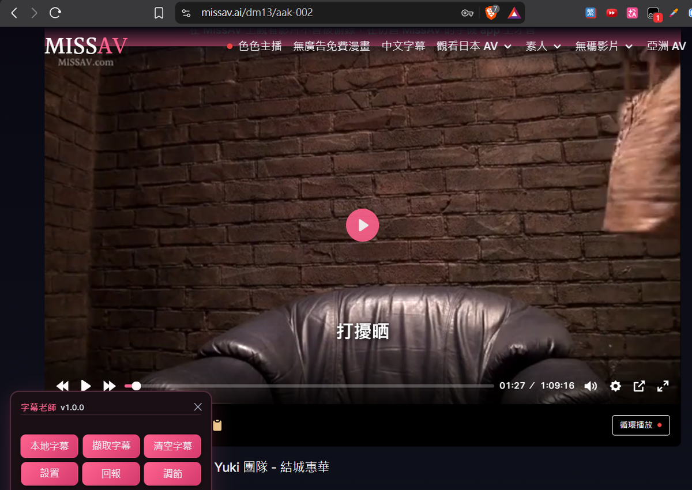
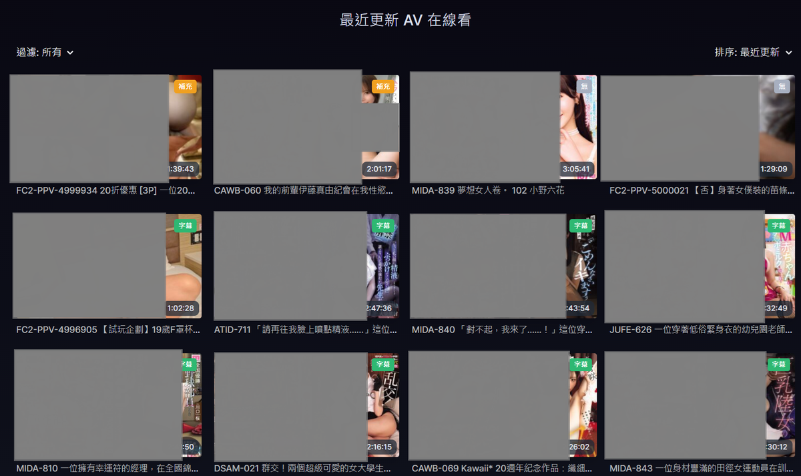
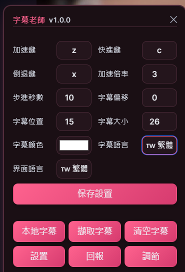
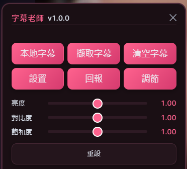
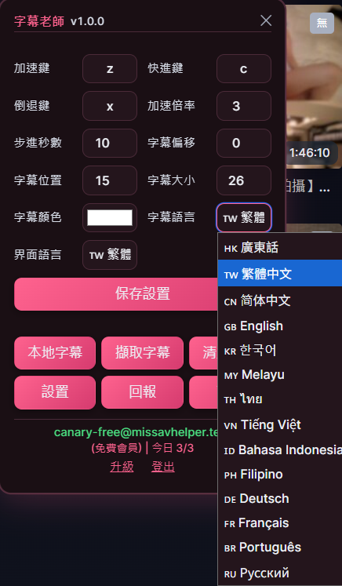
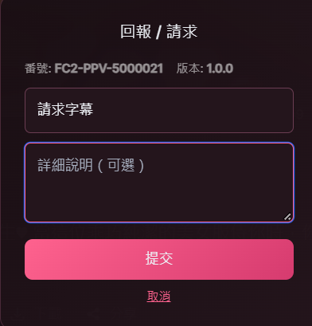

# SubSensei ｜ 字幕老師

> **贊助者資格僅能透過 [Buy Me a Coffee](https://buymeacoffee.com/neo2codes) 取得。**
> 任何其他管道聲稱可提供「贊助者資格」或「解鎖字幕」者，皆非官方來源。

[English version](README.en.md)

---

**SubSensei（字幕老師）** 是 [**字幕補完計劃（Subtitle Instrumentality Project，簡稱 SIP）**](PROJECT.md)
的官方瀏覽器工具。

計畫目標：**為 JAV 建立完整的多語言字幕庫。**
現況：**316,481 條字幕，14 種語言，持續成長中。**

**支援平台：🖥️ 電腦（Windows / macOS / Linux）· 📱 iOS · 🤖 Android**

---

### 主要功能一覽

| 主畫面 | 列表頁徽章 |
|---|---|
|  |  |

| 設置面板 | 畫面調節 |
|---|---|
|  |  |

| 字幕語言（14 種）| 回報 / 請求 |
|---|---|
|  |  |

---

## 目錄

- [平台支援](#平台支援)
- [安裝](#安裝)
- [支援網站](#支援網站)
- [字幕語言](#字幕語言)
- [免費與贊助者](#免費與贊助者)
- [贊助者福利](#贊助者福利)
- [使用方式](#使用方式)
- [快捷鍵](#快捷鍵)
- [常見問題](#常見問題)
- [隱私](#隱私)
- [授權範圍](#授權範圍)

---

## 平台支援

| 平台 | 瀏覽器 | Userscript Manager | 狀態 |
|---|---|---|---|
| **🖥️ Windows / macOS / Linux** | Chrome / Edge / Brave / Opera | [Tampermonkey](https://www.tampermonkey.net/) | ✅ |
| **🖥️ Windows / macOS / Linux** | Firefox | [Tampermonkey](https://addons.mozilla.org/firefox/addon/tampermonkey/) | ✅ |
| **🖥️ macOS** | Safari | [Tampermonkey](https://apps.apple.com/app/tampermonkey/id1482490089) 或 [Userscripts](https://apps.apple.com/us/app/userscripts/id1463298887) | ✅ |
| **📱 iOS / iPadOS** | Safari | [Userscripts](https://apps.apple.com/us/app/userscripts/id1463298887)（免費） | ✅ |
| **📱 iOS / iPadOS** | Safari | [Tampermonkey](https://apps.apple.com/app/tampermonkey/id6738342400) | ✅ |
| **🤖 Android** | **Firefox** | [Tampermonkey](https://addons.mozilla.org/android/addon/tampermonkey/) | ✅ **推薦** |
| **🤖 Android** | **Microsoft Edge** | [Tampermonkey](https://microsoftedge.microsoft.com/addons/detail/iikmkjmpaadaobahmlepeloendndfphd) | ✅ |
| **🤖 Android** | Chrome | — | ❌ **不支援**（Chrome Android 不支援擴充功能）|
| **🤖 Android** | Kiwi Browser | Tampermonkey Legacy | ⚠️ **不建議**（已停止維護）|

> **Android 用戶建議使用 Firefox**：官方支援 Tampermonkey，持續更新，最穩定。

---

## 安裝

### 🖥️ 電腦（Windows / macOS / Linux）

#### 第 1 步：安裝 Tampermonkey

| 瀏覽器 | 安裝 |
|---|---|
| **Chrome / Edge / Brave / Opera** | [Chrome Web Store](https://chromewebstore.google.com/detail/dhdgffkkebhmkfjojejmpbldmpobfkfo) |
| **Firefox** | [Firefox Add-ons](https://addons.mozilla.org/firefox/addon/tampermonkey/) |
| **macOS Safari** | [Tampermonkey (Mac App Store)](https://apps.apple.com/app/tampermonkey/id1482490089) |

#### 第 2 步：安裝 SubSensei

**[➜ 點此安裝 SubSensei](https://raw.githubusercontent.com/neo2codes/subsensei/main/dist/subsensei.user.js)**

Tampermonkey 會顯示安裝頁面，點擊「安裝」即可。

---

### 📱 iOS / iPadOS（Safari）

> iOS 需要使用 **Userscripts**（免費）或 **Tampermonkey**（付費）。
> 本節以 **Userscripts** 為例（免費、開源）。

#### 第 1 步：安裝 Userscripts

1. 開啟 App Store，搜尋 **Userscripts**
2. 安裝 [Userscripts](https://apps.apple.com/us/app/userscripts/id1463298887)
3. 開啟 Userscripts app，點擊「Set Userscripts Directory」
   選一個資料夾（例如「iCloud Drive → Userscripts」）

#### 第 2 步：啟用 Safari 擴充功能

1. 開啟 **設定** → **Safari** → **擴充功能**
2. 點擊 **Userscripts**
3. 開啟「**允許**」
4. 權限設定為「**允許所有網站**」

#### 第 3 步：安裝 SubSensei

1. 用 **Safari** 開啟此連結：
   **[➜ 安裝 SubSensei](https://raw.githubusercontent.com/neo2codes/subsensei/main/dist/subsensei.user.js)**

2. 頁面會顯示腳本原始碼
3. 點擊 Safari 網址欄左邊的 **「aA」** 圖示
4. 點擊 **Userscripts** → **「Install」**

> **或者**：直接在 Userscripts app 內點擊「+」→ 貼上腳本內容

#### 第 4 步：驗證

1. 用 Safari 開啟 missav.ai 任何一條影片
2. 左下角應該出現粉紅色「字幕」球
3. 如果沒有：
   - 檢查「設定 → Safari → 擴充功能 → Userscripts」已開啟
   - 檢查 Userscripts app 內腳本已啟用
   - 重新載入頁面

> **⚠️ iOS 提示**：iPhone 上沒有鍵盤快捷鍵（z/x/c/w/e/r/t/y/u），
> 請使用面板「調節」按鈕開啟滑桿調整畫面。

---

### 🤖 Android（推薦 Firefox）

> **無法使用 Chrome**：Chrome for Android 不支援擴充功能。
> 建議使用 **Firefox**（官方支援 Tampermonkey）或 **Microsoft Edge**。

#### 方案 A：Firefox（推薦）

**第 1 步：安裝 Firefox**

1. 開啟 Google Play，搜尋 **Firefox**
2. 安裝 [Firefox](https://play.google.com/store/apps/details?id=org.mozilla.firefox)

**第 2 步：安裝 Tampermonkey**

1. 用 Firefox 開啟 [Tampermonkey (Firefox Add-ons)](https://addons.mozilla.org/android/addon/tampermonkey/)
2. 點擊「**Add to Firefox**」
3. 點擊「**Add**」確認

**⚠️ 如果 Firefox 不允許安裝擴充功能：**
1. 開啟 Firefox → 右上角「⋮」→ **Settings**
2. 點擊 **Extensions**
3. 如果沒有 extensions 選項 → 您的 Firefox 版本過舊，請更新至最新版

**第 3 步：安裝 SubSensei**

用 Firefox 開啟：
**[➜ 安裝 SubSensei](https://raw.githubusercontent.com/neo2codes/subsensei/main/dist/subsensei.user.js)**

點擊「**安裝**」確認。

#### 方案 B：Microsoft Edge

**第 1 步：安裝 Edge**

從 [Google Play](https://play.google.com/store/apps/details?id=com.microsoft.emmx) 安裝。

**第 2 步：安裝 Tampermonkey**

1. 用 Edge 開啟 [Tampermonkey (Edge Add-ons)](https://microsoftedge.microsoft.com/addons/detail/iikmkjmpaadaobahmlepeloendndfphd)
2. 點擊「**Get**」→「**Add extension**」

**第 3 步：安裝 SubSensei**

與 Firefox 相同，開啟 .user.js 連結安裝。

#### ⚠️ 不建議 Kiwi Browser

Tampermonkey 官方 FAQ 已標明：

> **"Kiwi Browser is, while being quite popular, unmaintained.**
> **It is highly recommended to switch to browser that receives regular security updates."**

**→ 基於安全考量，建議使用 Firefox 或 Edge。**

---

### 第 4 步（所有平台）：註冊帳號

1. 開啟支援網站任何一條影片
2. 見到左下角粉紅色「字幕」球，點擊一下展開面板
3. 點擊「登入 / 註冊」
4. 填寫 email 與密碼註冊

**註冊後即可免費使用（每日 3 次字幕載入）。**

### 關於贊助者

若您在 [Buy Me a Coffee](https://buymeacoffee.com/neo2codes) 贊助 **USD$30 以上**，可獲得：

1. **每日 100 次字幕載入**（免費為 3 次）
2. **所選語言的新片字幕優先翻譯**
3. **批量請求字幕** —— 可請求整位女優或整個系列（例如 `SSIS`）的字幕

詳細說明請見下方 [贊助者福利](#贊助者福利)。

---

## 平台差異對照

| 功能 | 🖥️ 電腦 | 📱 iOS | 🤖 Android |
|---|---|---|---|
| **字幕自動載入** | ✅ | ✅ | ✅ |
| **列表頁徽章** | ✅ | ✅ | ✅ |
| **字幕語言切換（14 種）** | ✅ | ✅ | ✅ |
| **介面語言切換** | ✅ | ✅ | ✅ |
| **鍵盤快捷鍵** | ✅ | ❌ | ⚠️ 需外接鍵盤 |
| **畫面調節（滑桿）** | ✅ | ✅ | ✅ |
| **字幕樣式（顏色／大小／位置）** | ✅ | ✅ | ✅ |
| **登入／付款** | ✅ | ✅ | ✅ |

> **iOS / Android 沒有鍵盤**：使用面板「調節」按鈕調整畫面，
> 使用「設置」調整字幕樣式，功能完全相同。

---

## 支援網站

| 網站 | 域名 | 狀態 |
|---|---|---|
| **MISSAV** | `missav.ai` / `missav.com` / `missav.ws` / `missav.live` / `missav123.com` | ✅ |
| **Jable** | `jable.tv` | ✅ |
| **Jable 鏡像** | `fs1.app` | ✅ |
| **AV01** | `av01.media` / `av01.tv` | ✅ |
| Supjav | `supjav.com` | 🔜 計畫中 |
| JAVXXX | `javxxx.me` | 🔜 計畫中 |

### 列表頁徽章

一眼看出哪條影片有字幕：

| 徽章 | 顏色 | 說明 |
|---|---|---|
| **字幕** | 🟢 綠色 | 有完整字幕 |
| **殘次** | 🟠 橙色 | 有字幕但內容不完整（詳見下方）|
| **補充** | 🟡 黃色 | 迅雷來源（僅限中文語言）|
| **無** | ⚪ 灰色 | 沒有字幕 |

**關於「殘次」徽章：**

代表該影片有字幕檔案，但內容明顯不完整。常見原因包括：

- **影片本身對話極少** —— 例如純音樂、環境音、無對白演出
- **語音辨識（STT）未能準確識別** —— 背景音樂過大、多人同時說話、口音或錄音品質問題
- **上述原因導致字幕條目（cue）數量明顯偏少** —— 例如兩小時的影片只有個位數字幕

這類字幕仍可載入，但觀看體驗較差。若您發現某條影片的「殘次」判斷有誤，歡迎使用面板「回報」功能告知。

---

## 字幕語言

**14 種語言，切換即時生效：**

| 語言 | 現有字幕 |
|---|---|
| 🇭🇰 **廣東話** | 81,931 |
| 🇹🇼 **繁體中文** | 81,331 |
| 🇨🇳 **简体中文** | 81,331 |
| 🇬🇧 English | 39,482 |
| 🇰🇷 한국어 | 4,004 |
| 🇲🇾 Melayu | 187 |
| 🇹🇭 ไทย | 4,004 |
| 🇻🇳 Tiếng Việt | 4,004 |
| 🇮🇩 Bahasa Indonesia | 187 |
| 🇵🇭 Filipino | 4,004 |
| 🇩🇪 Deutsch | 4,004 |
| 🇫🇷 Français | 4,004 |
| 🇧🇷 Português | 4,004 |
| 🇷🇺 Русский | 4,004 |

**其他 10 種語言正在擴展中**（見 [PROJECT.md](PROJECT.md) 路線圖）。

---

## 免費與贊助者

| | 免費 | 贊助者 |
|---|---|---|
| **每日字幕載入** | 3 次 | **100 次** |
| **字幕庫存取** | ✅ 全部 | ✅ 全部 |
| **14 種語言** | ✅ | ✅ |
| **所有平台** | ✅ | ✅ |
| **新片字幕優先** | ❌ | ✅ |
| **批量請求字幕** | ❌ | ✅ |
| **費用** | 免費 | **贊助 USD$30 以上** |

---

## 贊助者福利

### 1. 每日 100 條字幕

免費帳號每日可載入 3 條字幕；贊助者額度為每日 **100 條**。

### 2. 新片字幕優先翻譯

若您贊助並指定某種語言，該語言的新片字幕會優先處理。
例如：贊助時說明「希望優先翻譯英文」，英文新片字幕就會排在待辦清單前面。

### 3. 批量請求字幕

您可以透過面板「回報」功能，請求整批字幕，例如：

- 某位女優的所有作品
- 某個系列（例如 `SSIS`、`MIDE`、`FC2-PPV`）的全部影片

**使用方法**：
1. 在任意頁面點擊面板的「回報」
2. 選擇「請求字幕」
3. 在說明欄位寫下您需要的女優名稱或系列代碼
4. 提交後會進入待辦清單，並依贊助者身分優先處理

---

### 如何成為贊助者

**這是一項贊助支持計畫，並非購買會員資格。**
您的贊助用於支持字幕翻譯、伺服器與開發工作。作為回饋，我們提供贊助者額度與上述福利。

點擊面板上的「升級」，確認 Email，然後前往
[Buy Me a Coffee](https://buymeacoffee.com/neo2codes) 贊助 **USD$30 以上**（Beta 期間限定）。

> **⚠️ 付款時請填寫您註冊 SubSensei 的 Email** —— 系統會自動對應並開通。
> 若付款 Email 與註冊 Email 不同，請透過 [GitHub Issues](https://github.com/neo2codes/subsensei/issues) 聯絡，並附上付款收據。

詳見 [PROJECT.md](PROJECT.md)。

---

## 使用方式

### 基本操作

| 動作 | 方法 |
|---|---|
| 展開／收起面板 | 點擊左下角粉紅色「字幕」球 |
| 載入字幕 | 自動（播放頁 800ms 後）或點擊「擷取字幕」 |
| 載入本地字幕 | 點擊「本地字幕」，選取 `.srt` 檔案 |
| 清空字幕 | 點擊「清空字幕」 |
| 切換字幕語言 | 「設置」→ 字幕語言 |
| 切換介面語言 | 「設置」→ 介面語言（中文／English）|
| 畫面調節 | 點擊「調節」→ 亮度／對比度／飽和度 |
| 請求字幕 | 點擊「回報」→ 選擇「請求字幕」→ 填寫片號或系列 |

### 設置項目

| 項目 | 說明 | 手機可用 |
|---|---|---|
| **加速鍵／快進鍵／倒退鍵** | 自訂快捷鍵 | 鍵盤限定 |
| **加速倍率** | 加速時的播放倍率 | ✅ |
| **步進秒數** | 快進／快退秒數 | 鍵盤限定 |
| **字幕偏移** | 字幕延遲（-10 到 +10 秒）| ✅ |
| **字幕位置／大小／顏色** | 字幕樣式 | ✅ |
| **字幕語言／介面語言** | 語言選擇 | ✅ |
| **調節滑桿** | 亮度／對比度／飽和度 | ✅ **手機請用此項** |

| 設置面板 | 畫面調節面板 |
|---|---|
|  |  |

---

## 快捷鍵

**僅限有鍵盤的裝置（電腦／手機外接鍵盤）**

| Key | 動作 |
|---|---|
| `z` | 快退 |
| `x` | 快進 |
| `c` | 加速（按住）|
| `w` / `e` | 亮度 −／+ |
| `r` / `t` | 對比度 −／+ |
| `y` / `u` | 飽和度 −／+ |
| `ESC` | 收起面板 |

> **📱 iOS / Android 沒有鍵盤**：使用「調節」按鈕開啟滑桿，功能完全相同。

---

## 常見問題

完整版請見 [docs/FAQ.md](docs/FAQ.md)

**快速解答：**

| 問題 | 答案 |
|---|---|
| 面板沒有出現？ | 確認在播放頁（不是首頁），檢查 Userscript Manager 是否啟用 |
| 字幕載入不了？ | 可能該影片沒有字幕，或每日額度已用完 |
| **Android 裝不了？** | **不能使用 Chrome，請用 Firefox 或 Edge** |
| **iOS 怎麼裝？** | 使用 Userscripts app 搭配 Safari 擴充功能 |
| 忘記密碼？ | 目前沒有自助重設功能，請使用 [GitHub Issues](https://github.com/neo2codes/subsensei/issues) |
| 付了款但沒開通？ | 確認付款 Email 與登入 Email 相同，重新載入頁面 |
| 想請求某系列字幕？ | 點擊面板「回報」→「請求字幕」，填寫女優名稱或系列代碼 |

---

## 隱私

**本腳本會向伺服器發送以下資料：**

| 資料 | 用途 |
|---|---|
| Email 與密碼 | 登入（經 PocketBase 加密傳輸）|
| 影片編號 | 額度計算與字幕查詢 |
| 字幕請求記錄 | 統計熱門字幕 |
| 瀏覽器 UA（回報時）| 除錯 |

**不會收集：**
- 瀏覽歷史
- 其他網站活動
- 個人身分資料

**所有資料儲存於 [PocketBase Cloud](https://pocketbase.io/)（新加坡）。**

**本腳本完全開源，可自行審查。**

---

## 授權範圍

**MIT License** —— 詳見 [LICENSE](LICENSE)

本 MIT 授權**僅涵蓋 userscript 原始碼**。

**不包括**：

| 項目 | 說明 |
|---|---|
| **字幕補完計劃資料庫（Subtitle Instrumentality Project，SIP）** | 所有 SRT 檔案、翻譯內容、字幕 metadata 均屬作者專有，不得複製、轉發、批量下載、重新上傳，或用於建立競品服務 |
| **托管後端** | PocketBase 實例、schema、server-side hooks、憑證 |
| **品牌標識** | SubSensei、字幕老師、字幕補完計劃、SIP 及相關標誌 |

**如果您想 fork 或轉發本腳本，請自行架設後端** ——
作者的托管服務（及其字幕庫）並不對第三方開放。

---

## 相關文件

| 文件 | 內容 |
|---|---|
| [PROJECT.md](PROJECT.md) | 計畫介紹、現況、路線圖 |
| [CHANGELOG.md](CHANGELOG.md) | 完整版本記錄 |
| [docs/FAQ.md](docs/FAQ.md) | 常見問題詳細版 |
| [LICENSE](LICENSE) | MIT 授權與適用範圍說明 |
| [README.en.md](README.en.md) | English version |
